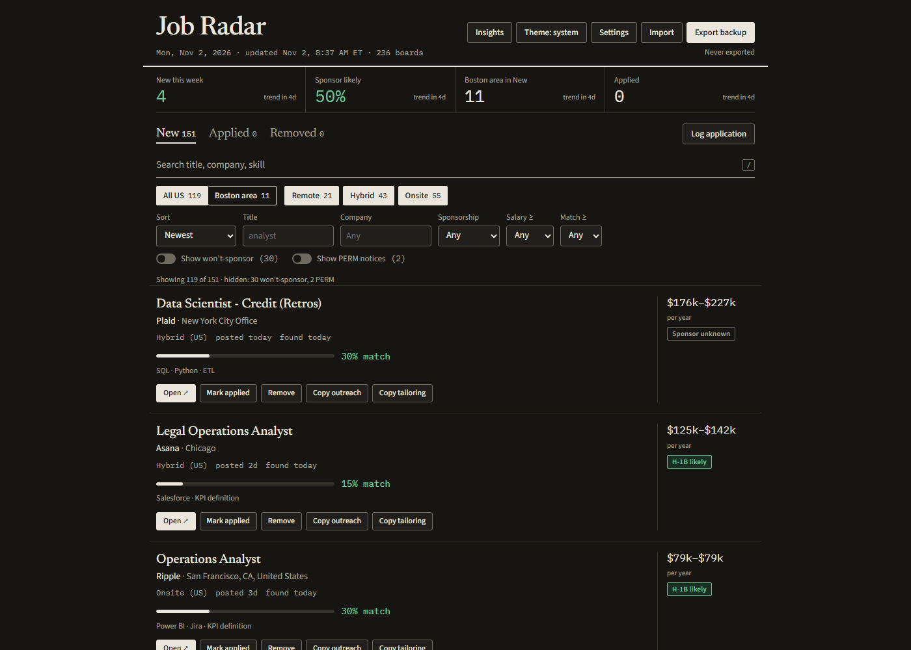
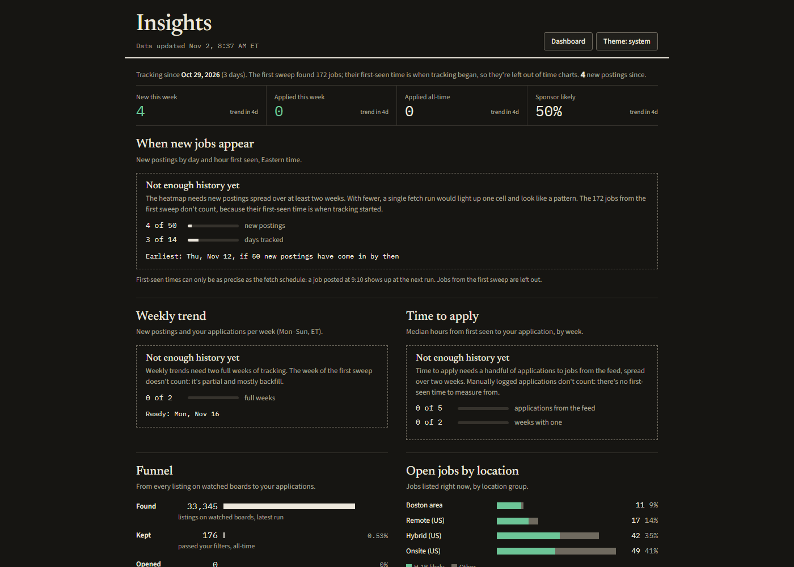

# job-radar

Tracks entry-level analytics jobs straight from public company job boards and
tags each one with location group, work mode, salary, an H-1B sponsorship
signal, a PERM-notice flag and a skills match percentage. A GitHub Actions cron
refreshes the data several times a day, and GitHub Pages serves the dashboard.

**Live dashboard:** https://hrishik01.github.io/job-radar/





## How it works

```
 GitHub Actions cron (weekdays every 2h, weekends once)
        |
        v
 fetcher/fetch.py ── Greenhouse / Lever / Ashby / Workday / SmartRecruiters public JSON APIs
        |             (polite: honest User-Agent, per-host delay, retries)
        |
        |  title filter -> years filter -> US filter -> tags
        |  (location group, work mode, salary, sponsorship, PERM, match %)
        v
 data/jobs.json ── committed back to the repo by the workflow
        |
        v
 GitHub Pages: site/index.html (dashboard) and site/insights.html (charts)
        your application status stays in your browser's localStorage
```

- **No AI at runtime.** Every tag is plain Python and regex.
- **Public job-board APIs only.** No LinkedIn, Indeed or Handshake scraping, and
  no spoofed browser headers.
- **Sponsorship** is `no` when the description says so (with equal-opportunity
  boilerplate excluded), `likely` when the employer matches the USCIS H-1B
  employer data, and `unknown` otherwise.
- **PERM notices** (postings for roles already filled by a sponsored employee)
  are flagged when two or more markers appear, and hidden behind a toggle.
- **Stable IDs** come from the board's own job ID, so reruns never duplicate a
  job, and a board that errors never removes jobs from the file.
- **The dashboard** is plain HTML, CSS and JavaScript with no build step. The
  insights charts are hand-built SVG and wait for enough history before drawing.

## Company badges

Job cards can carry a **Fortune 500** or **Unicorn** badge, built from two
public lists saved as company names only in `data/company_lists.json`:

| List | Source | Date |
| --- | --- | --- |
| 2026 Fortune 500 | [fortune.com/ranking/fortune500](https://fortune.com/ranking/fortune500/) | published 2026-06-03 |
| Unicorns (private, valued at $1B+) | [CB Insights unicorn tracker](https://www.cbinsights.com/research-unicorn-companies) | retrieved 2026-11-03; newest entry joined 2026-06-29 |

Unicorn status changes as companies raise, list or fold, so refresh the file
now and then with `python fetcher/company_lists.py`. A badge needs an exact
name match (after the same normalization as the USCIS lookup) or an alias in
`data/settings.json`; close-but-not-exact names are only logged for review.

## Layout

```
fetcher/        fetch pipeline, board adapters, filters, scoring, USCIS lookup
data/           settings.json (editable lists), companies.json, jobs.json
site/           dashboard and insights page
tests/          unittest smoke tests
.github/        scheduled fetch workflow
```

## Running locally

Python 3.11+.

```
python -m venv .venv
.venv/Scripts/pip install -r requirements.txt     # macOS/Linux: .venv/bin/pip

.venv/Scripts/python fetcher/fetch.py              # fetch every board
.venv/Scripts/python fetcher/fetch.py --only veeva # one board while tuning
.venv/Scripts/python -m unittest -v                # smoke tests

.venv/Scripts/python -m http.server 8765 --bind 127.0.0.1
# then open http://127.0.0.1:8765/site/
```

The dashboard reads `../data/jobs.json`, so it has to be served over HTTP;
opening the HTML file directly won't load any data.

## The scheduled run

`.github/workflows/fetch.yml` runs the fetcher every 2 hours on weekdays
from 6:23 AM to 10:23 PM ET, and once at 10:23 AM ET on weekends (times
assume EST, so they shift an hour later during daylight time). Runs sit at
:23 past the hour because GitHub delays or drops many scheduled jobs that
start exactly on the hour. Each run runs the tests, fetches, and commits
`data/jobs.json` if it changed. You can also start it by hand from the
**Actions** tab with **Run workflow**.

## Where the boards come from

`fetcher/discover.py` builds `data/companies.json`, and every board in it
was confirmed by the board's own API (at least one live job):

- **Public new-grad lists on GitHub** (SimplifyJobs new-grad and internship
  lists, speedyapply): direct Greenhouse, Lever, Ashby, SmartRecruiters and
  Workday links, named after the company in the list row.
- **USCIS H-1B sponsors:** likely slugs for the top 8,000 employers, tried
  on Greenhouse, Ashby, Lever and SmartRecruiters.
- **Workday for the top 500 sponsors:** the tenant's pod is found first
  (Workday answers differently for "no such tenant" and "wrong site"), then
  the most common careers-site names are tried. A board found this way is
  verified only if the tenant's own "About" text names it.

Boards found by guessing a slug on Lever, Ashby or Workday without a name
check stay "unknown" for sponsorship.

A few dead boards only produce warnings. If more than half the boards error,
the run fails and nothing is committed.

## Adding a company

1. Find the company's job board. Supported:
   - Greenhouse: `boards-api.greenhouse.io/v1/boards/<slug>/jobs`
   - Lever: `api.lever.co/v0/postings/<slug>`
   - Ashby: `api.ashbyhq.com/posting-api/job-board/<slug>`
   - Workday: `<tenant>.wd<pod>.myworkdayjobs.com/<site>`
   - SmartRecruiters: `api.smartrecruiters.com/v1/companies/<id>/postings`
2. Add an entry to `data/companies.json` with `"source": "manual"`:

   ```json
   {"name": "HubSpot", "board": "greenhouse", "slug": "hubspotjobs", "source": "manual", "status": "ok"}
   {"name": "Moderna", "board": "workday", "slug": "moderna", "tenant": "modernatx", "pod": 1, "site": "M_tx", "source": "manual", "status": "ok"}
   ```

   Boards that can't be read (iCIMS, Avature, or blocked) get
   `"status": "unsupported"` and a `note`.
3. Run `fetcher/fetch.py --only <slug>` and check the output.
4. If the company sponsors H-1B under a different legal name, add it to
   `uscis_aliases` in `data/settings.json` after checking the USCIS entry's
   city, state and industry.

## Your data

Applications, removed jobs and preferences live only in your browser's
`localStorage`. Use **Export backup** on the dashboard to save them as JSON,
and **Import** to restore them on another device.
